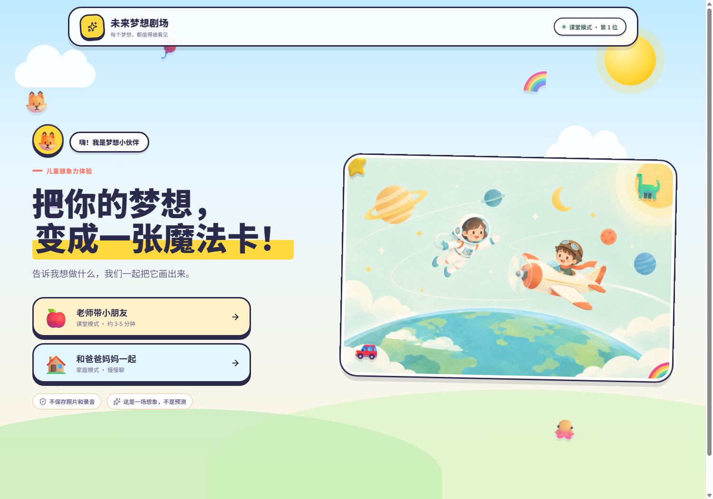
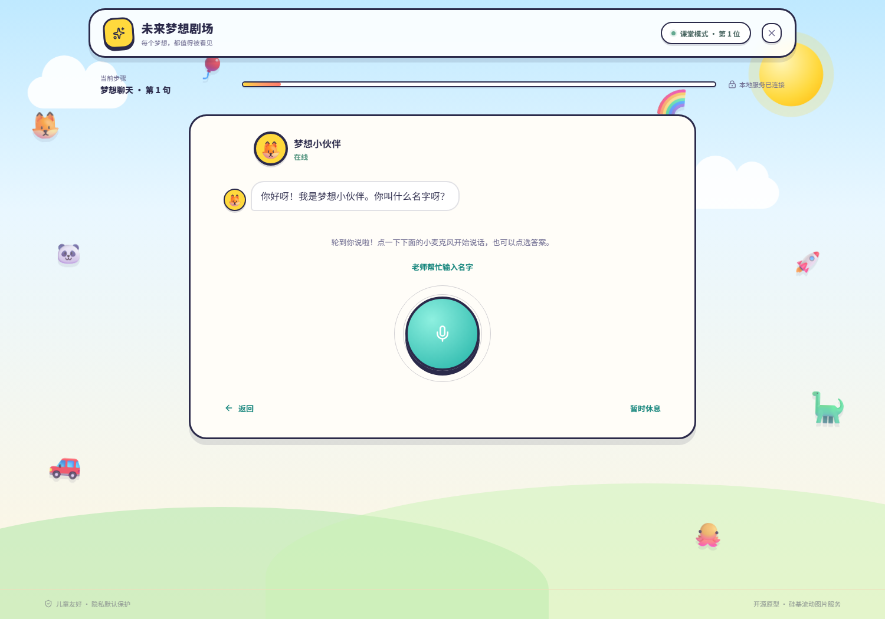
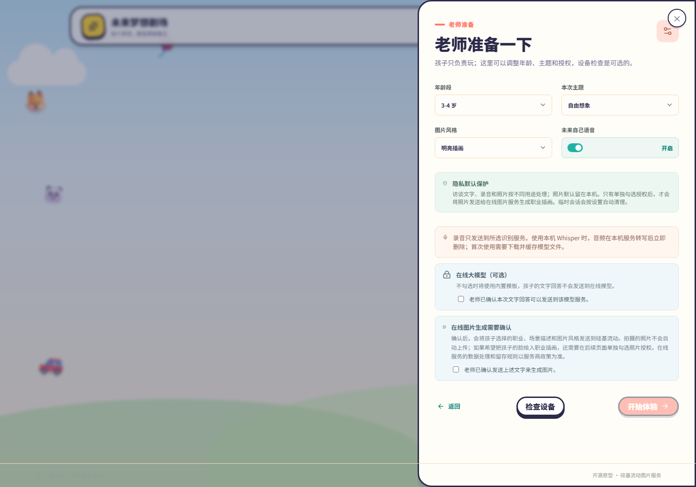

# 未来梦想剧场 · Future Dream Theatre

> 面向幼儿园课堂与家庭的「梦想探索」互动原型：孩子说出自己的梦想，系统生成一张**未来梦想卡**，再让孩子和想象中的「未来的自己」聊几句。

<!-- screenshots -->


<p>
  <a href="https://github.com/tz120012/future-dream-theatre/actions/workflows/ci.yml"></a>
  
  
  
  
</p>

**English** — A prototype for kindergarten classrooms and families. A child expresses a dream by voice, tapping picture choices, or an optional photo; the app turns it into a "future dream card" illustration and lets the child talk with an imagined future self. Speech recognition runs **locally** (faster-whisper). Everything else degrades gracefully: without an API key or network, conversations fall back to built-in templates and images fall back to a local card, so a lesson never gets stuck.

> 这是一个**产品原型**，不是可直接商用的成品。它面向幼儿使用，请在成人陪伴下使用，并注意 README 中「隐私与安全」一节的说明。

## 为什么做这个

幼儿园的「梦想」话题常常停在「你想当什么」这一句。这个原型想把它延长成一次完整的体验：

1. 孩子用自己的话讲出梦想（语音 / 点选图片选项）；
2. 系统把三句话整理成几个**可以确认的方向**，而不是直接替孩子贴职业标签；
3. 生成一张属于他的「未来梦想卡」；
4. 孩子还能和「未来的自己」对话，听对方用孩子的语气回应。

<p>
  
  
</p>

## 功能

**课堂体验**
- 老师课堂模式 / 家庭模式两种入口，课堂上一位小朋友约 3~5 分钟。
- 老师准备面板：年龄段、主题、图片风格、是否开启语音播报，以及每项在线能力的**逐项授权勾选**。
- 三轮儿童友好的梦想访谈，支持语音回答，也可只点图片选项。
- 访谈后汇总兴趣、想象场景和 2~3 个可确认方向，由孩子或老师选定后再生成。
- 摄像头拍照 / 上传正脸照，可选「卡通形象」「用照片」「不用照片」。
- 「精细绘本」与「快速卡通」两种出图速度，适配不同课堂时长。
- 「未来的自己」多轮对话，带最近几轮文字上下文，可语音播报。
- 梦想卡下载；「下一位小朋友」一键切换并清理临时数据。

**工程侧**
- FastAPI 本地 API：会话、语音转写、语音合成、梦想卡任务轮询。
- 本机 faster-whisper 中文语音识别，录音转写后立即删除，浏览器只负责录音。
- 语音播报用 CosyVoice2 神经音色（8 种音色 × 3 种语气），失败自动回退浏览器 TTS。
- 出图失败原因分级返回（内容审核 / 余额 / Key / 超时），页面给出可操作提示。
- 一键部署包：目标电脑只需装 Docker Desktop，**首次运行也不联网下载模型**。

## 快速开始

### 方式一：Docker Compose（推荐）

```bash
git clone https://github.com/<your-account>/future-dream-theatre.git
cd future-dream-theatre
docker compose up --build
```

打开 <http://localhost:8080/>，接口健康检查在 <http://localhost:8000/api/health>。

- 端口只绑定 `127.0.0.1`，不会向局域网开放（摄像头/麦克风也要求 localhost 或 HTTPS）。
- 设置与 Whisper 模型保存在 Docker volume `app-data` 中，重建容器不会丢。
- 首次语音识别会下载 Whisper `base` 模型（约 145 MB），之后从磁盘加载，不再联网。

### 方式二：本地开发

```bash
# 后端
cd backend
python -m venv .venv && .venv\Scripts\activate    # macOS/Linux: source .venv/bin/activate
pip install -r requirements.txt
uvicorn main:app --reload --port 8000

# 前端（另开一个终端）
cd frontend
npm install
npm run dev
```

打开 <http://localhost:5173/>。Vite 已把 `/api` 代理到 `localhost:8000`。

### 方式三：给老师的离线部署包

面向「目标电脑不装 Node/Python、不需要命令行」的场景：

1. 开发机执行 `powershell -ExecutionPolicy Bypass -File .\scripts\build-deploy-bundle.ps1 -Version 2.0.0`；
2. 把生成的 `dist\Forzh-Deploy\`（约 360 MB）整个拷到目标电脑；
3. 目标电脑装一次 Docker Desktop，双击 `一键部署.bat`。

详细步骤、端口冲突、WSL、摄像头权限等排障，见 [deploy/部署说明.md](deploy/部署说明.md)。

## 配置

不配置任何 Key 也能完整走一遍流程（对话用内置模板、图片用占位卡）。想要真实的 AI 对话 / 插画 / 语音，需要一把 [硅基流动](https://cloud.siliconflow.cn/) API Key，在页面**左上角图标 → 设置**里填写，或用环境变量：

| 环境变量 | 默认值 | 说明 |
| --- | --- | --- |
| `SILICONFLOW_API_KEY` | 空 | 对话、图片、语音共用一把 Key |
| `LLM_PROVIDER` | `siliconflow` | `template` = 只用内置模板（离线、免费） |
| `IMAGE_PROVIDER` | `mock` | `siliconflow` = 真实生成插画 |
| `TTS_PROVIDER` | `siliconflow` | `browser` = 浏览器语音（离线可用） |
| `STT_PROVIDER` | `browser` | `local_whisper` = 本机转写（离线可用） |
| `WHISPER_MODEL` | `base` | `tiny` / `base` / `small` |
| `WHISPER_MODEL_DIR` | `backend/data/whisper` | 模型缓存目录 |
| `SILICONFLOW_CHAT_MODEL` | `deepseek-ai/DeepSeek-V4.1-Flash` | 对话模型 |
| `SILICONFLOW_IMAGE_MODEL` | `Tongyi-MAI/Z-Image` | 精细绘本 / 快速档 / 保脸编辑模型分别可配 |
| `SILICONFLOW_TTS_VOICE` | `FunAudioLLM/CosyVoice2-0.5B:bella` | 8 种预置音色 |
| `SILICONFLOW_TTS_TONE` | `warm` | `warm` / `lively` / `calm` |
| `RETENTION_MINUTES` | `30` | 会话与临时图片在本机保留时长 |

完整模板见 [`backend/.env.example`](backend/.env.example)，部署包另有 [`deploy/.env.example`](deploy/.env.example)。

## 隐私与安全

这个项目处理的是**儿童的声音、照片和表达**，请认真读这几条：

- **默认不出网**：语音识别在本机完成，录音转写后即删除；默认图片为 Mock、对话为内置模板。
- **逐项授权**：老师/家长需要在准备面板上分别勾选「对话文字可发送到在线模型」「梦想文字可发送到图片服务」「本张照片可作为参考图」，未勾选就只走本地能力。
- **照片只在勾选后上传**；不勾选时照片只在本机内存中使用。
- **API Key 明文保存在本机**（`data/settings.json` 或 Docker volume），读取接口不会返回 Key，也不会写进浏览器存储。
- **没有账号体系、没有多租户隔离**：只适合本机或可信的自托管环境，**不要直接暴露到公网**。需要局域网访问时，请自行加反向代理、HTTPS 和访问控制。
- 在线服务的计费、数据处理与留存规则取决于服务商（当前实现为硅基流动），启用前请查阅其最新政策。

## 目录结构

```
backend/                 FastAPI 本地服务（会话、转写、合成、出图任务）
  main.py                全部 API 与在线服务编排
  settings.py            环境变量与 .env 加载
frontend/                React + TypeScript + Vite
  src/App.tsx            全部页面与交互状态机
  src/services/          API 封装与本地设置
deploy/                  离线部署包模板与「一键部署」脚本
scripts/                 开发机打包脚本
docs/screenshots/        README 截图
PRD.md                   产品需求文档
TECHNICAL-PLAN.md        技术方案
UI-PROTOTYPE.md          页面原型说明
```

## 文档

- [产品需求（PRD）](PRD.md)
- [技术方案](TECHNICAL-PLAN.md)
- [页面原型](UI-PROTOTYPE.md)
- [图片生成链路说明](IMAGE-GENERATION.md)
- [部署说明（给老师）](deploy/部署说明.md)
- [安全策略](SECURITY.md) · [贡献指南](CONTRIBUTING.md)

## 贡献

欢迎提 Issue 和 PR。这个项目最需要的是**真实的课堂反馈**：哪些话孩子听不懂、哪一步会卡住、哪种语气更合适。提交前请先看 [CONTRIBUTING.md](CONTRIBUTING.md)，并且**不要提交任何 API Key、儿童照片或录音**。

## 许可证

[MIT](LICENSE)。可以自由使用、修改、商用，保留版权声明即可。

## 致谢

- [faster-whisper](https://github.com/SYSTRAN/faster-whisper) / [CTranslate2](https://github.com/OpenNMT/CTranslate2)：本机语音识别
- [硅基流动 SiliconFlow](https://cloud.siliconflow.cn/)：对话、图片、CosyVoice2 语音合成
- [FastAPI](https://fastapi.tiangolo.com/) · [React](https://react.dev/) · [Vite](https://vite.dev/) · [nginx](https://nginx.org/)
